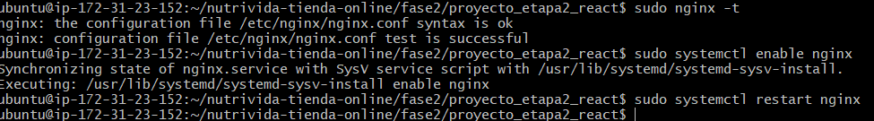
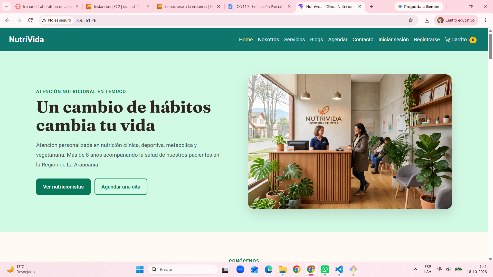
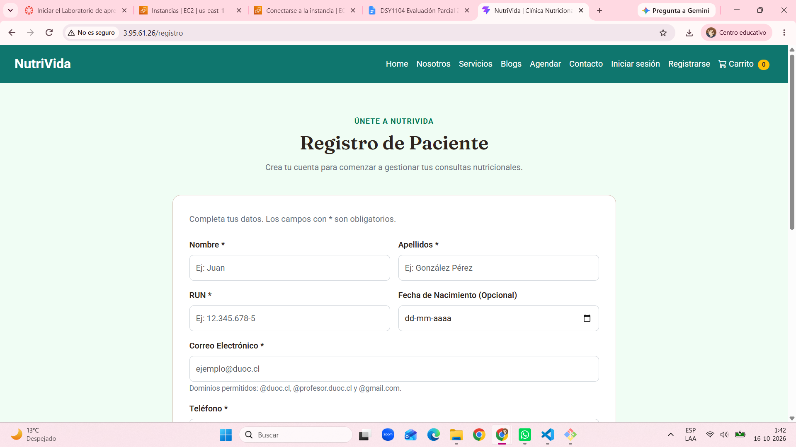

# ☁️ Despliegue de NutriVida en AWS EC2

La aplicación React de NutriVida se publicó en una instancia AWS EC2 del laboratorio AWS Academy, utilizando Nginx para servir la compilación de producción.

**Fecha del despliegue:** 16 de octubre de 2026.  
**URL registrada:** [http://3.95.61.26](http://3.95.61.26)

## Configuración del entorno

| Elemento | Configuración |
|---|---|
| Nombre de la instancia | nutrivida-react |
| Región | Estados Unidos, Norte de Virginia — us-east-1 |
| Sistema operativo | Ubuntu Server 24.04 LTS |
| Tipo de instancia | t3.micro |
| Almacenamiento | 20 GiB, gp3 |
| Node.js | 24.22.0 |
| npm | 11.19.1 |
| Git | 2.43.0 |
| Servidor web | Nginx |
| Puerto de publicación | HTTP 80 |

El grupo de seguridad permite conexiones SSH por el puerto 22 desde la IP autorizada y tráfico HTTP por el puerto 80 desde Internet.

La clave privada de conexión se conserva fuera del repositorio.

## Preparación del servidor

Desde una conexión SSH con el usuario `ubuntu`, se actualizaron los paquetes y se instalaron las herramientas necesarias:

```bash
sudo apt update
sudo apt upgrade -y
sudo apt install -y curl build-essential git
```

Se instaló NVM y se seleccionó Node.js 24 para mantener la misma versión principal utilizada en el desarrollo de NutriVida:

```bash
curl -o- https://raw.githubusercontent.com/nvm-sh/nvm/v0.40.3/install.sh | bash
source ~/.bashrc
nvm install 24
nvm use 24
```

## Descarga y compilación del proyecto

Se descargó la rama `main` del repositorio y se ingresó a la aplicación de la fase 2:

```bash
git clone --branch main --single-branch https://github.com/soofigonb/nutrivida-tienda-online.git
cd nutrivida-tienda-online/fase2/proyecto_etapa2_react
npm ci
npm run build
```

La compilación terminó correctamente y generó la carpeta `dist/`.

## Publicación con Nginx

Se instaló Nginx y se copiaron los archivos compilados:

```bash
sudo apt install -y nginx
sudo cp -r dist/. /var/www/html/
```

El archivo `/etc/nginx/sites-available/default` se configuró así:

```nginx
server {
    listen 80 default_server;
    listen [::]:80 default_server;

    server_name _;
    root /var/www/html;
    index index.html;

    location / {
        try_files $uri $uri/ /index.html;
    }
}
```

La directiva `try_files` permite entregar `index.html` cuando se solicita una ruta administrada por React Router, como `/registro` o `/agendar`.

Se comprobó la configuración y se habilitó el servicio:

```bash
sudo nginx -t
sudo systemctl enable nginx
sudo systemctl restart nginx
```

La comprobación mostró `syntax is ok` y `test is successful`.

## Evidencias

### Configuración de Nginx



### Inicio publicado en AWS



### Página de Registro



## Actualizar la aplicación publicada

Después de integrar los cambios en `main`, ejecutar desde la carpeta React del servidor:

```bash
cd ~/nutrivida-tienda-online/fase2/proyecto_etapa2_react
git pull --ff-only origin main
npm ci
npm run build
sudo cp -r dist/. /var/www/html/
sudo nginx -t
sudo systemctl reload nginx
```

Continuar con la copia y recarga únicamente si la instalación y compilación terminan correctamente.

## Disponibilidad y alcance

La publicación utiliza HTTP y no tiene un certificado HTTPS configurado.

Nginx continúa sirviendo la aplicación al cerrar la conexión SSH, siempre que la instancia permanezca encendida.

El entorno pertenece a AWS Academy. La disponibilidad depende de la sesión del laboratorio y su presupuesto. La IPv4 pública puede cambiar después de detener e iniciar la instancia; en ese caso, se debe actualizar la URL documentada.

La aplicación conserva su alcance frontend: los datos se almacenan en el navegador mediante `localStorage`, sin base de datos remota ni procesamiento real de pagos.

## Referencias docentes

- Guía 2.1.2: Configuración de React + Vite + React Bootstrap en una instancia EC2 de AWS.
- Guía 2.2.2: Configuración de React en un entorno de desarrollo EC2 de AWS.