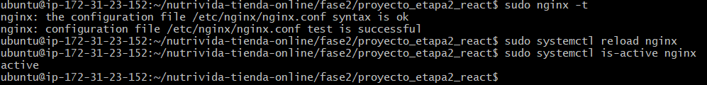
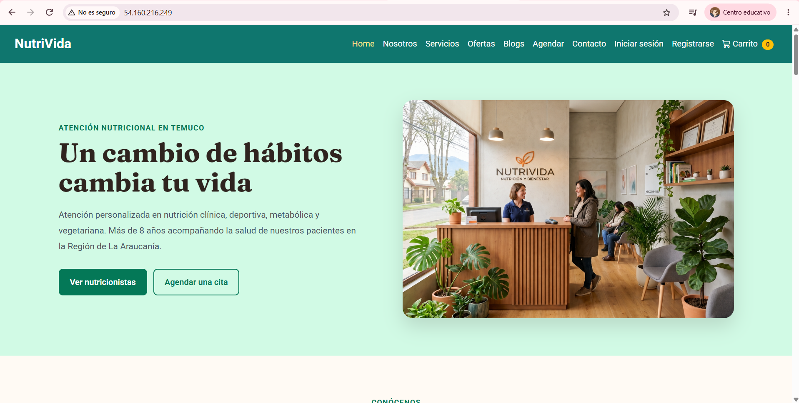
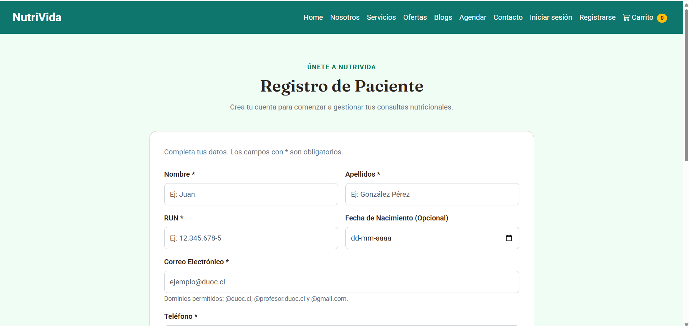
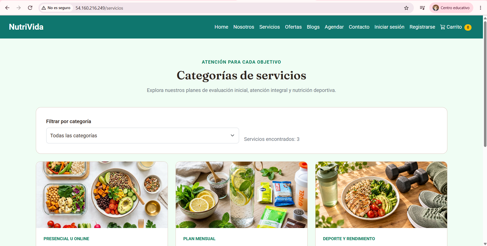
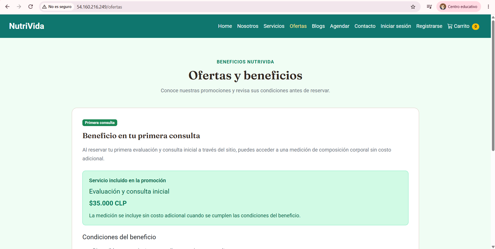
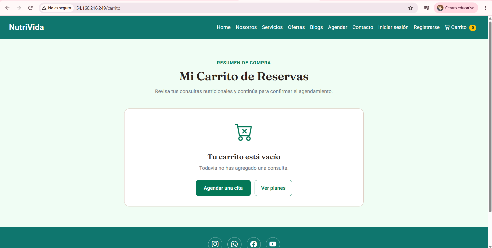

# ☁️ Despliegue de NutriVida en AWS EC2

La aplicación React de NutriVida se publicó en una instancia AWS EC2 del laboratorio AWS Academy. Nginx sirve los archivos de la compilación de producción generada con Vite.

**Fecha de actualización:** 16 de octubre de 2026.  
**URL pública registrada:** [http://54.160.216.249](http://54.160.216.249)  
**Rama utilizada para la publicación:** `main`.  
**Documentación y evidencias:** `docs/ev2/despliegue_aws/`.

## Configuración del entorno

| Elemento | Configuración |
|---|---|
| Nombre de la instancia | nutrivida-react |
| Región | Estados Unidos, Norte de Virginia — us-east-1 |
| Sistema operativo | Ubuntu Server 24.04 LTS |
| Tipo de instancia | t3.micro |
| Almacenamiento | 20 GiB, gp3 |
| Node.js | 24.22.0 |
| npm | 11.19.1 |
| Git | 2.43.0 |
| Servidor web | Nginx |
| Usuario de conexión | ubuntu |
| IPv4 pública registrada | 54.160.216.249 |
| Puerto de publicación | HTTP 80 |

El grupo de seguridad permite conexiones SSH por el puerto 22 desde la IP autorizada y tráfico HTTP por el puerto 80 desde Internet.

La clave privada de conexión se conserva fuera del repositorio.

## Conexión al servidor

Desde Git Bash, con la clave privada guardada en la carpeta Descargas:

```bash
cd ~/Downloads
ssh -i "nutrivida-key.pem" ubuntu@54.160.216.249
```

Los comandos de instalación, compilación y publicación de los siguientes apartados se ejecutan dentro del servidor Ubuntu.

## Preparación inicial del servidor

Se actualizaron los paquetes y se instalaron las herramientas necesarias:

```bash
sudo apt update
sudo apt upgrade -y
sudo apt install -y curl build-essential git
```

Se instaló NVM y se seleccionó Node.js 24 para mantener la misma versión principal utilizada durante el desarrollo:

```bash
curl -o- https://raw.githubusercontent.com/nvm-sh/nvm/v0.40.3/install.sh | bash
source ~/.bashrc
nvm install 24
nvm use 24
```

Esta preparación corresponde a la configuración inicial del servidor. Para publicar cambios posteriores se utiliza el procedimiento de actualización.

## Descarga y compilación del proyecto

Se descargó la rama `main` del repositorio y se ingresó a la aplicación de la fase 2:

```bash
git clone --branch main --single-branch https://github.com/soofigonb/nutrivida-tienda-online.git
cd nutrivida-tienda-online/fase2/proyecto_etapa2_react
npm ci
npm run build
```

El comando `npm ci` instala las dependencias registradas en `package-lock.json`.

La compilación genera la carpeta `dist/`, que contiene los archivos que publica Nginx.

## Publicación con Nginx

Se instaló Nginx y se copiaron los archivos compilados:

```bash
sudo apt install -y nginx
sudo cp -r dist/. /var/www/html/
```

El archivo `/etc/nginx/sites-available/default` se configuró de la siguiente manera:

```nginx
server {
    listen 80 default_server;
    listen [::]:80 default_server;

    server_name _;
    root /var/www/html;
    index index.html;

    location / {
        try_files $uri $uri/ /index.html;
    }
}
```

La directiva `try_files` entrega `index.html` cuando la dirección solicitada corresponde a una ruta administrada por React Router. Esto permite abrir directamente o recargar páginas como `/registro`, `/servicios` y `/ofertas`.

Se validó la configuración y se habilitó el servicio:

```bash
sudo nginx -t
sudo systemctl enable nginx
sudo systemctl restart nginx
```

## Actualización de la aplicación publicada

Después de integrar los cambios en `main`, se actualiza el repositorio del servidor y se genera una nueva compilación.

Primero, comprobar el estado del repositorio:

```bash
cd ~/nutrivida-tienda-online/fase2/proyecto_etapa2_react
git status
```

Con el directorio de trabajo limpio, ejecutar:

```bash
git pull --ff-only origin main
npm ci
npm run build
```

Continuar únicamente si la actualización, instalación y compilación terminan correctamente:

```bash
sudo cp -r dist/. /var/www/html/
sudo nginx -t
```

Si la validación de Nginx indica `syntax is ok` y `test is successful`, recargar el servicio y comprobar su estado:

```bash
sudo systemctl reload nginx
sudo systemctl is-active nginx
```

La comprobación del servicio debe mostrar:

```text
active
```

Finalmente, abrir la URL pública y presionar **Ctrl + F5** para cargar la versión actualizada.

La publicación utiliza los archivos de `dist/`. No requiere mantener abierto el servidor de desarrollo de Vite.

## Páginas de la versión publicada

La actualización incorpora el catálogo por categorías, la página de ofertas y beneficios y el flujo de revisión y confirmación de reservas del carrito.

| Ruta | Contenido |
|---|---|
| `/` | Inicio y presentación de NutriVida. |
| `/servicios` | Catálogo de planes con filtro por categoría. |
| `/ofertas` | Beneficio de primera consulta y sus condiciones. |
| `/registro` | Formulario de registro de pacientes. |
| `/login` | Acceso de pacientes y administradores. |
| `/agendar` | Selección de plan, nutricionista, fecha y horario. |
| `/carrito` | Consultas seleccionadas, revisión y confirmación de reservas. |
| `/admin` | Panel administrativo con acceso según el rol de la sesión. |

Para verificar la navegación de React Router, se debe abrir una ruta interna directamente y recargar con **F5**. La página debe mantenerse disponible sin mostrar un error 404 de Nginx.

## Evidencias del despliegue

Las capturas se almacenan en `docs/ev2/despliegue_aws/evidencias/`.

| Archivo | Evidencia |
|---|---|
| `configuracion-nginx.png` | Validación de configuración, recarga y estado activo de Nginx. |
| `inicio-aws.png` | Página de inicio desde la dirección pública. |
| `registro-aws.png` | Formulario de registro publicado. |
| `servicios-aws.png` | Catálogo de servicios por categorías. |
| `ofertas-aws.png` | Página de ofertas y beneficios. |
| `carrito-aws.png` | Página del carrito de reservas. |

### Validación y estado de Nginx

La configuración pasó la comprobación y el servicio respondió `active`.



### Inicio publicado en AWS



### Registro de pacientes



### Catálogo de servicios



### Ofertas y beneficios



### Carrito de reservas



## Disponibilidad y dirección pública

La publicación utiliza HTTP y no tiene un certificado HTTPS configurado.

Nginx continúa sirviendo la aplicación al cerrar la conexión SSH, siempre que la instancia permanezca encendida.

El entorno pertenece a AWS Academy. Su disponibilidad depende de la sesión del laboratorio y del presupuesto asignado.

La IPv4 pública puede cambiar después de detener e iniciar la instancia. En ese caso, se debe consultar la nueva dirección en EC2 y actualizar:

- La URL pública de este documento.
- El comando de conexión SSH.
- Los enlaces de los README general y de la fase 2.
- Las capturas utilizadas como evidencia de la dirección publicada.

## Alcance de la aplicación

NutriVida corresponde a una simulación frontend. Los datos de pacientes, nutricionistas, sesión, carrito y citas se conservan en el navegador mediante `localStorage`.

El almacenamiento depende del navegador y del origen utilizado. Los datos guardados en localhost o en una IP anterior no se trasladan automáticamente a la nueva dirección pública.

La aplicación no utiliza una base de datos remota ni procesa pagos o envíos reales de correos. El acceso administrativo representa una simulación de roles en el frontend.

## Referencias docentes

- Guía 2.1.2: Configuración de React + Vite + React Bootstrap en una instancia EC2 de AWS.
- Guía 2.2.2: Configuración de React en un entorno de desarrollo EC2 de AWS.